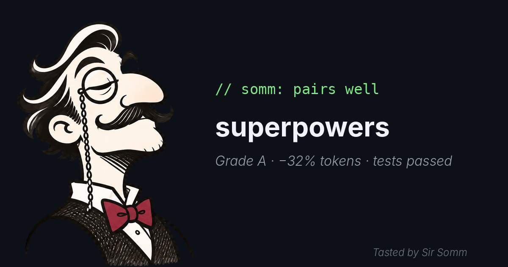
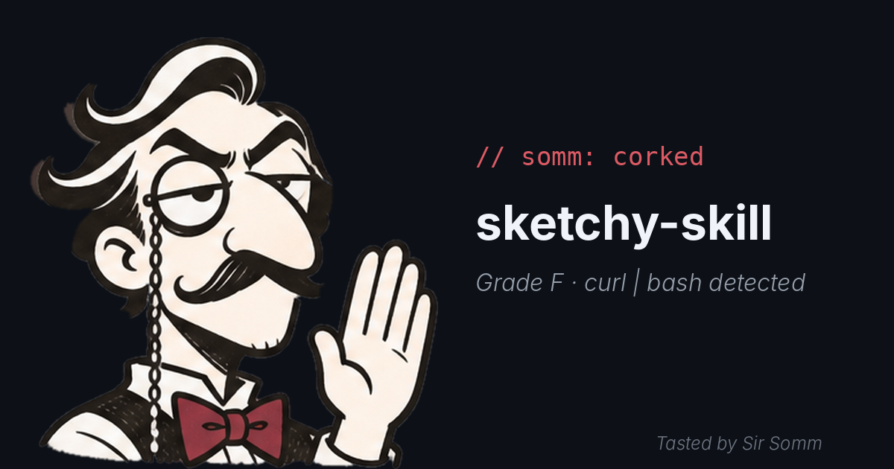

# somm

<p align="center">
  
</p>

somm is a desktop app and CLI for browsing agent skills, scanning them, comparing runs in a copied project, and installing them for Claude Code or Codex. The catalog currently uses sample data.

Sir Somm, a monocled sommelier, tastes every skill before it reaches your project. Each verdict is one line:

- `// somm: pairs well`: recommended
- `// somm: needs to breathe`: conditional
- `// somm: corked`: not recommended or blocked

<table>
  <tr>
    <td align="center"></td>
    <td align="center"></td>
  </tr>
</table>

<p align="center">
  
</p>

somm never reads, stores, or relays your login credentials or tokens.

## Runs and safety

Choose **Subscription** to use an already logged-in local CLI, or **Isolated** to supply an API key (desktop memory only; CLI uses `ANTHROPIC_API_KEY` or `CODEX_API_KEY`). Choose **Quick** for one run per arm or **Thorough** for three per arm. Runs also use an agent call for the verdict and may use another for task proposals. Review the usage notice before starting; Thorough can consume substantial subscription quota. Codex does not enforce the budget option.

Secret masking is best-effort: transformed keys may leak, and CLI masking does not join fragments across events. Use a budget-limited throwaway key for Isolated.

Lite copies the project but is not an OS sandbox. A modified test script can launch arbitrary subprocesses with host permissions, and event-based monitoring can miss unlogged accesses. Skills with scripts, hooks or MCP are restricted to static checks. Submodules and Git LFS content may be missing; installing dependencies can require network access. Subscription runs can include shared agent configuration; Codex may add trusted project entries to its own configuration. Symlink installs cannot be restored from backup. Non-default `CODEX_HOME` filesystem access is not supported by the desktop capability.

## Development

Requires pnpm, Node.js ^22.13.0 or >=23.4.0, Rust and Tauri's platform prerequisites.

```sh
pnpm install
pnpm --filter desktop dev            # web preview
pnpm --filter desktop tauri dev      # desktop
pnpm -r test
pnpm -r check
pnpm -r build
cargo test --manifest-path apps/desktop/src-tauri/Cargo.toml
cargo check --manifest-path apps/desktop/src-tauri/Cargo.toml
pnpm --filter desktop tauri build --debug
```

See [CLI usage](apps/cli/README.md). The app and CLI share a SQLite database in `~/Library/Application Support/io.github.seongjooon.somm`, or `SOMM_DATA_DIR` if set.
